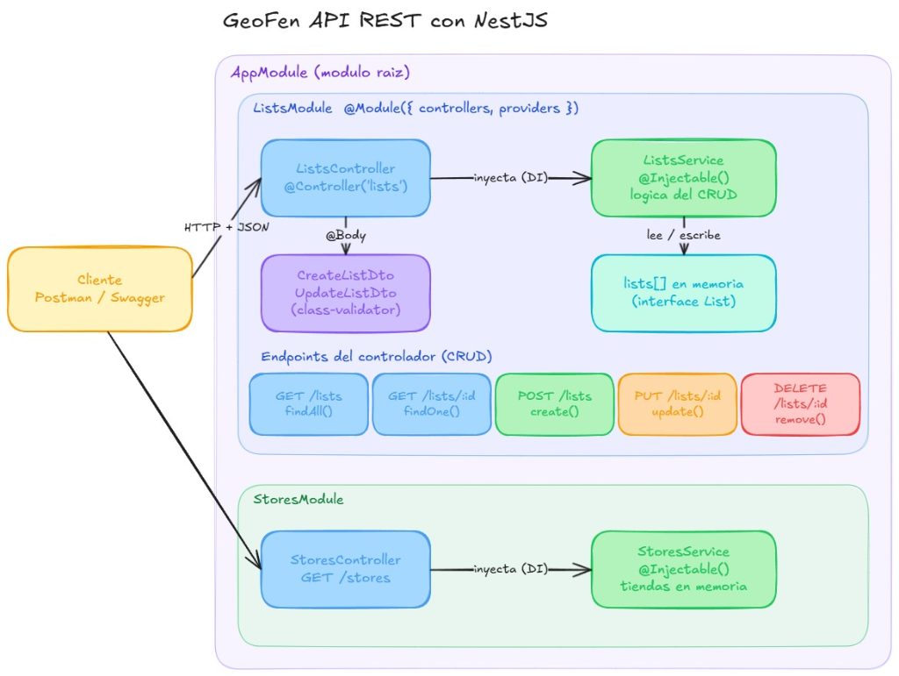

# GeoFen API REST 📍🛒

API RESTful construida con **NestJS** y **TypeScript** para la gestión de listas de compras y consulta de establecimientos comerciales de referencia. Diseñada bajo un enfoque arquitectónico modular, limpio y didáctico (KISS) para comprender en profundidad los conceptos esenciales de backend: **Módulos**, **Controladores**, **Servicios**, **DTOs** e **Inyección de Dependencias (DI)**.

---

## 📌 1. ¿Qué es GeoFen?

**GeoFen** es una plataforma orientada a la optimización de compras cotidianas. Permite a los usuarios crear sus listas de compras y, con base en su ubicación geográfica, descubrir tiendas cercanas y comparar precios de productos.

> **Alcance de esta entrega:**  
> Implementación del **núcleo backend base (MVP)**: una API RESTful sin interfaces gráficas. Las listas se guardan temporalmente en memoria, las tiendas se almacenan en **PostgreSQL** (con Docker y **TypeORM**), y la API se documenta con **Swagger** y colecciones de **Postman**.

---

## 🏗️ 2. Arquitectura y Flujo de Datos

La aplicación sigue el patrón estándar de NestJS con separación estricta de responsabilidades (Single Responsibility Principle):



### Diagrama de Flujo en Texto
```
[ Cliente HTTP ] (Postman / Swagger)
       │
       ▼  HTTP Request (JSON + Verbo)
┌────────────────────────────────────────────────────────┐
│  ValidationPipe Global (main.ts)                       │
│  - Limpia propiedades no deseadas (whitelist: true)    │
│  - Valida reglas de tipo con class-validator           │
└──────────────────────┬─────────────────────────────────┘
                       │
                       ▼  DTO Validado
┌────────────────────────────────────────────────────────┐
│  Controller (ListsController / StoresController)       │
│  - Define rutas y verbos HTTP (@Get, @Post, etc.)      │
│  - Transforma parámetros (@Param con ParseIntPipe)     │
│  - No tiene lógica de negocio                          │
└──────────────────────┬─────────────────────────────────┘
                       │
                       ▼  Invocación de Método
┌────────────────────────────────────────────────────────┐
│  Service (@Injectable() - Singleton)                   │
│  - Contiene las reglas del negocio                     │
│  - Aplica Retorno Temprano (Early Return)              │
│  - Lanza excepciones nativas (NotFoundException, etc.) │
└──────────────────────┬─────────────────────────────────┘
                       │
                       ▼  Lectura / Escritura
┌────────────────────────────────────────────────────────┐
│  Almacenamiento                                        │
│  - lists: List[] (arreglo en memoria)                  │
│  - stores: Repository<Store> -> PostgreSQL (TypeORM)   │
└──────────────────────┬─────────────────────────────────┘
                       │
                       ▼  HTTP Response (200, 201, 400, 404)
[ Cliente HTTP ] (Postman / Swagger)
```

---

## 📂 3. Estructura del Proyecto

```text
geofen-api/
├── docs/
│   └── diagrama-geofen.png         # Diagrama de arquitectura del sistema
├── postman/
│   ├── geofen-collection.json      # Colección interactiva de pruebas
│   └── README.md                   # Guía de ejecución en Postman
├── src/
│   ├── lists/                      # Módulo de Listas de Compras (CRUD)
│   │   ├── dto/
│   │   │   ├── create-list.dto.ts  # Validaciones para creación
│   │   │   └── update-list.dto.ts  # Validaciones para actualización
│   │   ├── interfaces/
│   │   │   └── list.interface.ts   # Contrato de datos de la lista
│   │   ├── lists.controller.ts     # Enrutamiento HTTP
│   │   ├── lists.module.ts         # Encapsulamiento del módulo
│   │   └── lists.service.ts        # Lógica de negocio y persistencia en memoria
│   ├── stores/                     # Módulo de Tiendas (Solo lectura)
│   │   ├── entities/
│   │   │   └── store.entity.ts     # Entidad TypeORM (tabla stores)
│   │   ├── stores.controller.ts    # Enrutamiento HTTP
│   │   ├── stores.module.ts        # Encapsulamiento del módulo
│   │   └── stores.service.ts       # Consultas con TypeORM y seed de tiendas de Pasto
│   ├── app.module.ts               # Módulo raíz que conecta Listas y Tiendas
│   └── main.ts                     # Bootstrap, ValidationPipe y Swagger en /api
├── .env.example                    # Variables de entorno de ejemplo (puerto y BD)
├── docker-compose.yml              # Servicios PostgreSQL y pgAdmin
├── package.json                    # Dependencias y scripts
├── tsconfig.json                   # Configuración del compilador TypeScript
└── README.md                       # Documentación principal
```

---

## 🛠️ 4. Comandos Utilizados y Cómo Correr el Proyecto

### Dependencias Instaladas
El proyecto utiliza únicamente las librerías necesarias para cumplir el alcance:
```bash
# Dependencias principales del framework
npm install @nestjs/common @nestjs/core @nestjs/platform-express reflect-metadata rxjs

# Validación de entradas y DTOs
npm install class-validator class-transformer

# Documentación interactiva OpenAPI / Swagger
npm install @nestjs/swagger
```

### Ejecución en Entorno Local

1. **Instalar dependencias:**
   ```bash
   npm install
   ```

2. **Compilar el proyecto (TypeScript a JavaScript en `/dist`):**
   ```bash
   npm run build
   ```

3. **Iniciar en modo desarrollo con recarga en vivo (Watch mode):**
   ```bash
   npm run start:dev
   ```

4. **Acceder a los servicios:**
   - **API Base:** `http://localhost:3000`
   - **Documentación Swagger UI:** `http://localhost:3000/api`

---

## 🐘 Base de datos (Docker + PostgreSQL)

Las tiendas se leen desde **PostgreSQL**, que corre en un contenedor de Docker junto con **pgAdmin** para administrarla visualmente.

### Prerrequisitos
- **Docker Desktop** instalado y en ejecución.
- Node.js y npm.

### Puesta en marcha
```bash
# 1. Crear el archivo de variables de entorno a partir del ejemplo
cp .env.example .env

# 2. Levantar PostgreSQL y pgAdmin en segundo plano
docker compose up -d

# 3. Instalar dependencias de la API
npm install

# 4. Iniciar la API en modo desarrollo
npm run start:dev
```

- **Puerto:** PostgreSQL se publica en el host por el puerto `5433` (variable `DB_PORT`) para no chocar con un PostgreSQL local que use el 5432.
- **Datos de ejemplo:** al iniciar, si la tabla `stores` está vacía, la API inserta las 3 tiendas de Pasto automáticamente.

### Acceso con pgAdmin
1. Abre **http://localhost:5050** e inicia sesión con `admin@geofen.com` / `admin_password`.
2. Registra un servidor nuevo (**Add New Server**) con estos datos:
   - **Host name/address:** `postgres` (nombre del servicio dentro de la red de Docker, no `localhost`).
   - **Port:** `5432` (puerto interno del contenedor).
   - **Database:** `geofen_db` · **Username:** `geofen_user` · **Password:** `geofen_password`.

### Detener los servicios
```bash
docker compose down      # Detiene los contenedores y conserva los datos
docker compose down -v   # Detiene los contenedores y ELIMINA los datos (volúmenes)
```

---

## 📡 5. Tabla de Endpoints de la API

Todos los endpoints usan nombres en plural, sin verbos en las URLs, respetando las convenciones RESTful:

| Módulo | Método HTTP | Ruta | Método del Service | Código HTTP | Descripción |
| :--- | :--- | :--- | :--- | :--- | :--- |
| **Lists** | `GET` | `/lists` | `findAll()` | `200 OK` | Retorna todas las listas de compras |
| **Lists** | `GET` | `/lists/:id` | `findOne(id)` | `200 OK` / `404` | Detalle de una lista por ID numérico |
| **Lists** | `POST` | `/lists` | `create(dto)` | `201 Created` | Crea una lista validando el body |
| **Lists** | `PUT` | `/lists/:id` | `update(id, dto)` | `200 OK` / `404` | Reemplazo completo usando spread operator |
| **Lists** | `DELETE` | `/lists/:id` | `remove(id)` | `200 OK` / `404` | Elimina una lista por ID |
| **Stores** | `GET` | `/stores` | `findAll()` | `200 OK` | Lista de tiendas precargadas (Pasto) |
| **Stores** | `GET` | `/stores/:id` | `findOne(id)` | `200 OK` / `404` | Detalle de una tienda por ID |

---

## 💡 6. Conceptos Clave Explicados

1. **Módulo (`@Module`):**  
   Organiza la aplicación en bloques funcionales cohesivos. Cada módulo declara qué controladores expone (`controllers`) y qué servicios provee (`providers`).
2. **Controlador (`@Controller`):**  
   Responsable únicamente del protocolo HTTP: escuchar peticiones en una URL, extraer parámetros (`@Param`, `@Body`) y delegar el trabajo al servicio.
3. **Servicio (`@Injectable`):**  
   Aloja la lógica de negocio y las operaciones sobre los datos. Nunca sabe de HTTP ni de peticiones web directas; solo procesa datos y retorna resultados o lanza excepciones.
4. **Inyección de Dependencias (DI) & Singleton:**  
   NestJS instancia los servicios una sola vez al arrancar y los inyecta en el constructor de los controladores. Esto evita crear múltiples instancias (`new ListsService()`) y asegura que el estado compartido (el arreglo en memoria de listas) se mantenga consistente.
5. **DTO y `class-validator`:**  
   Define el contrato estricto de entrada. Si un cliente envía campos no válidos o tipos incorrectos, el `ValidationPipe` rechaza la petición con `400 Bad Request` antes de que toque la lógica del servicio.
6. **Retorno Temprano (Early Return):**  
   Patrón de programación limpia donde los casos de error o condiciones no cumplidas se evalúan al inicio de la función para cortar la ejecución (`throw new NotFoundException(...)`), eliminando la necesidad de bloques `else` anidados.

