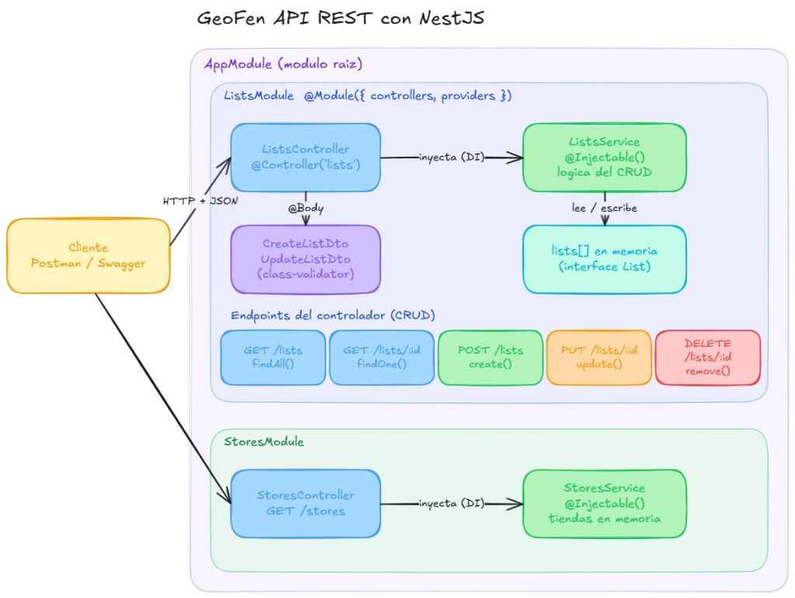

# GeoFen API REST

API RESTful construida con **NestJS** y **TypeScript** para la gestión de listas de compras y consulta de establecimientos comerciales de referencia. Diseñada bajo un enfoque arquitectónico modular, limpio y didáctico (KISS) para comprender en profundidad los conceptos esenciales de backend: **Módulos**, **Controladores**, **Servicios**, **DTOs**, **Inyección de Dependencias (DI)** y **persistencia con TypeORM**.

---

## 1. ¿Qué es GeoFen?

**GeoFen** es una plataforma orientada a la optimización de compras cotidianas. Permite a los usuarios crear sus listas de compras y, con base en su ubicación geográfica, descubrir tiendas cercanas y comparar precios de productos.

> **Alcance de esta entrega:**  
> Implementación del **núcleo backend base (MVP)**: una API RESTful con persistencia en **PostgreSQL** mediante **TypeORM**, documentada con **Swagger** y colecciones de **Postman**.

---

## 2. Arquitectura y Flujo de Datos

La aplicación sigue el patrón estándar de NestJS con separación estricta de responsabilidades (Single Responsibility Principle):



### Diagrama de Flujo en Texto
```
[ Cliente HTTP ] (Postman / Swagger)
       │
       ▼  HTTP Request (JSON + Verbo)
┌────────────────────────────────────────────────────────┐
│  ValidationPipe Global (main.ts)                       │
│  - Limpia propiedades no deseadas (whitelist: true)    │
│  - Valida reglas de tipo con class-validator           │
└──────────────────────┬─────────────────────────────────┘
                       │
                       ▼  DTO Validado
┌────────────────────────────────────────────────────────┐
│  Controller (ListsController / StoresController)       │
│  - Define rutas y verbos HTTP (@Get, @Post, etc.)      │
│  - Transforma parámetros (@Param con ParseIntPipe)     │
│  - No tiene lógica de negocio                          │
└──────────────────────┬─────────────────────────────────┘
                       │
                       ▼  Invocación de Método
┌────────────────────────────────────────────────────────┐
│  Service (@Injectable() - Singleton)                   │
│  - Contiene las reglas del negocio                     │
│  - Aplica Retorno Temprano (Early Return)              │
│  - Lanza excepciones nativas (NotFoundException, etc.) │
└──────────────────────┬─────────────────────────────────┘
                       │
                       ▼  Lectura / Escritura (TypeORM)
┌────────────────────────────────────────────────────────┐
│  Persistencia en PostgreSQL (Docker Compose)           │
│  - Entidad List  -> tabla lists                        │
│  - Entidad Store -> tabla stores (único chain+address) │
└──────────────────────┬─────────────────────────────────┘
                       │
                       ▼  HTTP Response (200, 201, 400, 404, 409)
[ Cliente HTTP ] (Postman / Swagger)
```

---

## 3. Estructura del Proyecto

```text
geofen-api/
├── docs/
│   └── diagrama-geofen.png         # Diagrama de arquitectura del sistema
├── postman/
│   ├── geofen-collection.json      # Colección interactiva de pruebas
│   └── README.md                   # Guía de ejecución en Postman
├── src/
│   ├── lists/                      # Módulo de Listas de Compras (CRUD)
│   │   ├── dto/
│   │   │   ├── create-list.dto.ts  # Validaciones para creación
│   │   │   └── update-list.dto.ts  # Validaciones para actualización
│   │   ├── entities/
│   │   │   └── list.entity.ts      # Entidad TypeORM (tabla lists)
│   │   ├── lists.controller.ts     # Enrutamiento HTTP
│   │   ├── lists.module.ts         # Encapsulamiento del módulo
│   │   └── lists.service.ts        # Lógica de negocio y acceso a PostgreSQL
│   ├── stores/                     # Módulo de Tiendas (CRUD)
│   │   ├── dto/
│   │   │   ├── create-store.dto.ts # Validaciones para creación
│   │   │   └── update-store.dto.ts # Actualización parcial (PartialType)
│   │   ├── entities/
│   │   │   └── store.entity.ts     # Entidad TypeORM (tabla stores)
│   │   ├── stores.controller.ts    # Enrutamiento HTTP
│   │   ├── stores.module.ts        # Encapsulamiento del módulo
│   │   └── stores.service.ts       # Lógica de negocio y acceso a PostgreSQL
│   ├── categories/                 # Módulo de Categorías (CRUD)
│   │   ├── dto/
│   │   │   ├── create-category.dto.ts
│   │   │   └── update-category.dto.ts
│   │   ├── entities/
│   │   │   └── category.entity.ts  # Entidad TypeORM (tabla categories, name único)
│   │   ├── categories.controller.ts
│   │   ├── categories.module.ts
│   │   └── categories.service.ts
│   ├── products/                   # Módulo de Productos (CRUD y relación con Category)
│   │   ├── dto/
│   │   │   ├── create-product.dto.ts
│   │   │   └── update-product.dto.ts
│   │   ├── entities/
│   │   │   └── product.entity.ts   # Entidad TypeORM (tabla products, ManyToOne Category)
│   │   ├── products.controller.ts
│   │   ├── products.module.ts
│   │   └── products.service.ts
│   ├── prices/                     # Módulo de Precios (reporte y consulta)
│   │   ├── dto/
│   │   │   └── report-price.dto.ts # Validación de reporte de precio
│   │   ├── entities/
│   │   │   └── price.entity.ts     # Entidad TypeORM (tabla prices, ManyToOne Product y Store)
│   │   ├── prices.controller.ts
│   │   ├── prices.module.ts
│   │   └── prices.service.ts
│   ├── common/
│   │   └── transformers/
│   │       └── decimal.transformer.ts # Convierte decimales de PostgreSQL a number
│   ├── app.module.ts               # Módulo raíz que conecta Listas, Tiendas, Categorías, Productos, Precios y TypeORM
│   └── main.ts                     # Bootstrap, ValidationPipe y Swagger en /api
├── .env.example                    # Variables de entorno de ejemplo
├── docker-compose.yml              # PostgreSQL y pgAdmin
├── package.json                    # Dependencias y scripts
├── tsconfig.json                   # Configuración del compilador TypeScript
└── README.md                       # Documentación principal
```

---

## 4. Comandos Utilizados y Cómo Correr el Proyecto

### Dependencias Instaladas
El proyecto utiliza únicamente las librerías necesarias para cumplir el alcance:
```bash
# Dependencias principales del framework
npm install @nestjs/common @nestjs/core @nestjs/platform-express reflect-metadata rxjs

# Validación de entradas y DTOs
npm install class-validator class-transformer

# Documentación interactiva OpenAPI / Swagger
npm install @nestjs/swagger

# Conexión a PostgreSQL con TypeORM y variables de entorno
npm install @nestjs/typeorm typeorm pg @nestjs/config
```

### Ejecución en Entorno Local

0. **Levantar la base de datos con Docker (requiere Docker Desktop):**
   ```bash
   cp .env.example .env
   docker compose up -d
   ```
   - PostgreSQL queda en `localhost:5433` (puerto configurable con `DB_PORT` en `.env`).
   - pgAdmin queda en `http://localhost:5050` (`admin@geofen.com` / `admin_password`). Para registrar el servidor usar host `postgres`, puerto `5432`, usuario `geofen_user`, contraseña `geofen_password`.
   - `docker compose down` detiene los contenedores; `docker compose down -v` además borra los datos.

1. **Instalar dependencias:**
   ```bash
   npm install
   ```

2. **Compilar el proyecto (TypeScript a JavaScript en `/dist`):**
   ```bash
   npm run build
   ```

3. **Iniciar en modo desarrollo con recarga en vivo (Watch mode):**
   ```bash
   npm run start:dev
   ```
   - Con `DB_SYNCHRONIZE=true` en `.env`, TypeORM crea las tablas `lists` y `stores` al arrancar la API.
   - La base arranca vacía. No hay tiendas precargadas, así que hay que crearlas con `POST /stores`.

4. **Acceder a los servicios:**
   - **API Base:** `http://localhost:3000`
   - **Documentación Swagger UI:** `http://localhost:3000/api`

---

## 5. Tabla de Endpoints de la API

Todos los endpoints usan nombres en plural, sin verbos en las URLs, respetando las convenciones RESTful:

| Módulo | Método HTTP | Ruta | Método del Service | Código HTTP | Descripción |
| :--- | :--- | :--- | :--- | :--- | :--- |
| **Lists** | `GET` | `/lists` | `findAll()` | `200 OK` | Retorna todas las listas de compras |
| **Lists** | `GET` | `/lists/:id` | `findOne(id)` | `200 OK` / `404` | Detalle de una lista por ID numérico |
| **Lists** | `POST` | `/lists` | `create(dto)` | `201 Created` | Crea una lista validando el body |
| **Lists** | `PUT` | `/lists/:id` | `update(id, dto)` | `200 OK` / `404` | Reemplazo completo de nombre e items |
| **Lists** | `DELETE` | `/lists/:id` | `remove(id)` | `200 OK` / `404` | Elimina una lista por ID |
| **Stores** | `GET` | `/stores` | `findAll()` | `200 OK` | Lista todas las tiendas guardadas en la base |
| **Stores** | `GET` | `/stores/:id` | `findOne(id)` | `200 OK` / `404` | Detalle de una tienda por ID |
| **Stores** | `POST` | `/stores` | `create(dto)` | `201 Created` / `400` / `409` | Crea una tienda. `409` si ya existe la misma cadena y dirección |
| **Stores** | `PATCH` | `/stores/:id` | `update(id, dto)` | `200 OK` / `400` / `404` / `409` | Actualización parcial de una tienda |
| **Stores** | `DELETE` | `/stores/:id` | `remove(id)` | `200 OK` / `404` | Elimina una tienda por ID |
| **Categories** | `GET` | `/categories` | `findAll()` | `200 OK` | Retorna todas las categorías |
| **Categories** | `GET` | `/categories/:id` | `findOne(id)` | `200 OK` / `404` | Detalle de una categoría por ID |
| **Categories** | `POST` | `/categories` | `create(dto)` | `201 Created` / `400` / `409` | Crea una categoría (nombre único) |
| **Categories** | `PATCH` | `/categories/:id` | `update(id, dto)` | `200 OK` / `400` / `404` / `409` | Actualización parcial de categoría |
| **Categories** | `DELETE` | `/categories/:id` | `remove(id)` | `200 OK` / `404` | Elimina una categoría por ID |
| **Products** | `GET` | `/products` | `findAll(categoryId?)` | `200 OK` / `404` | Catálogo de productos (filtro opcional por `categoryId`) |
| **Products** | `GET` | `/products/:id` | `findOne(id)` | `200 OK` / `404` | Detalle de un producto por ID |
| **Products** | `POST` | `/products` | `create(dto)` | `201 Created` / `400` / `404` / `409` | Registra un producto (barcode único, categoría opcional) |
| **Products** | `PATCH` | `/products/:id` | `update(id, dto)` | `200 OK` / `400` / `404` / `409` | Actualización parcial de un producto |
| **Products** | `DELETE` | `/products/:id` | `remove(id)` | `200 OK` / `404` | Elimina un producto por ID |
| **Prices** | `GET` | `/prices` | `findAll(productId?, storeId?)` | `200 OK` | Consulta precios con filtros opcionales por producto y tienda |
| **Prices** | `POST` | `/prices` | `reportPrice(dto)` | `201 Created` / `400` / `404` | Reporta precio de un producto en una tienda |

### Ejemplo de body para `POST /stores`

```json
{
  "name": "Éxito Panamericana",
  "chain": "Éxito",
  "address": "Av. Panamericana # 22-10, Pasto, Nariño",
  "latitude": 1.2136,
  "longitude": -77.2811,
  "schedule": "Lun-Dom 8:00-21:00"
}
```

- `latitude` debe estar entre `-90` y `90`, y `longitude` entre `-180` y `180`.
- `schedule` es opcional.
- No se pueden repetir una `chain` y una `address` juntas. Si se intenta, la API responde `409 Conflict`.

---

## 6. Conceptos Clave Explicados

1. **Módulo (`@Module`):**  
   Organiza la aplicación en bloques funcionales cohesivos. Cada módulo declara qué controladores expone (`controllers`) y qué servicios provee (`providers`).
2. **Controlador (`@Controller`):**  
   Responsable únicamente del protocolo HTTP: escuchar peticiones en una URL, extraer parámetros (`@Param`, `@Body`) y delegar el trabajo al servicio.
3. **Servicio (`@Injectable`):**  
   Aloja la lógica de negocio y las operaciones sobre los datos. Nunca sabe de HTTP ni de peticiones web directas; solo procesa datos y retorna resultados o lanza excepciones.
4. **Inyección de Dependencias (DI) & Singleton:**  
   NestJS instancia los servicios una sola vez al arrancar y los inyecta en el constructor de los controladores. Esto evita crear múltiples instancias (`new ListsService()`) y hace que todos los controladores usen el mismo servicio y, por tanto, la misma conexión a la base de datos.
5. **DTO y `class-validator`:**  
   Define el contrato estricto de entrada. Si un cliente envía campos no válidos o tipos incorrectos, el `ValidationPipe` rechaza la petición con `400 Bad Request` antes de que toque la lógica del servicio.
6. **Retorno Temprano (Early Return):**  
   Patrón de programación limpia donde los casos de error o condiciones no cumplidas se evalúan al inicio de la función para cortar la ejecución (`throw new NotFoundException(...)`), eliminando la necesidad de bloques `else` anidados.
7. **Entidad (TypeORM):**  
   Clase decorada con `@Entity` que representa una tabla de PostgreSQL. Sus columnas (`@Column`) definen la estructura de los datos guardados. La restricción única de `stores` (`chain` + `address`) evita tiendas duplicadas a nivel de base de datos.
